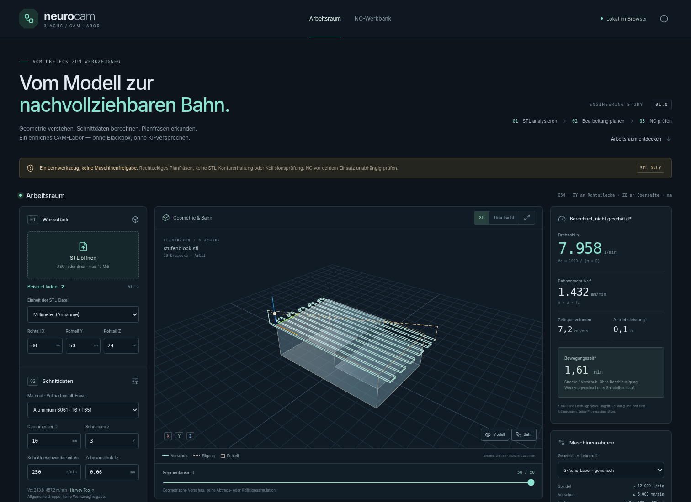
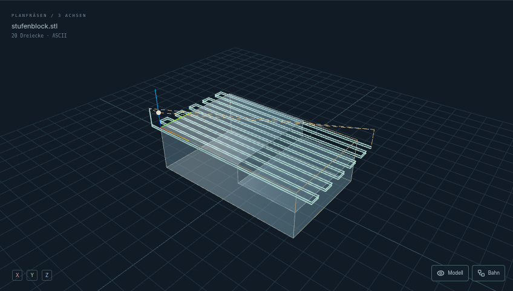
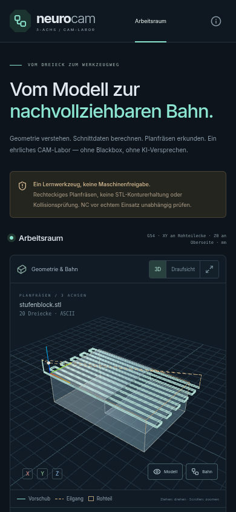

# NeuroCAM

### CAM, nachvollziehbar.

Ein eigenständiges, browserbasiertes **3-Achs-CAM-Labor**: STL analysieren, Schnittdaten nachrechnen und rechteckige Planfräsbahnen als NC erzeugen und betrachten. Entwickelt als technisches Portfolio-Projekt von Hannes Schwede, mit KI-Unterstützung.

**React · TypeScript · Three.js / React Three Fiber · Vite · Vitest · Playwright**

> **Keine Maschinenfreigabe.** Der generierte NC-Code ist ein Lern-/Entwicklungsergebnis. Vor realem Einsatz sind eine unabhängige Simulation, Kontrolle von Nullpunkten, Werkzeuglängen, Aufspannung und Steuerungsdialekt sowie Dry Run und fachliche Freigabe erforderlich. Es gibt **keine Kollisions- oder Abtragssimulation**.



## Was tatsächlich funktioniert

- **STL-Import:** ASCII und Binary, einschließlich Binärdateien mit irreführendem `solid`-Header. Bounding Box, Dreiecksanzahl, exakte Kanten-/Orientierungsprüfung und orientiertes Volumen bei geschlossenem Netz. Maximal 10 MiB / 100.000 Dreiecke.
- **Einheiten bewusst wählen:** STL enthält keine verlässliche Einheit. Millimeter sind die sichtbare Annahme; Zoll wird explizit mit 25,4 skaliert. Das Netz wird zur Ansicht an XY-Minimum und Z-Oberseite ausgerichtet, nicht automatisch gedreht.
- **Nachprüfbare Schnittdaten:** Drehzahl, Bahnvorschub, nominelles Zeitspanvolumen und Näherungsleistung. Vier Werkstoffgruppen; Vc-Bereiche aus einer geöffneten Herstellerquelle, Annahmen für fz, kc und Wirkungsgrad separat ausgewiesen.
- **Maschinenrahmen:** zwei ausdrücklich generische Lehrprofile. Prüfung von Drehzahl, Vorschub, Nennleistung und Werkzeugmittelpunkt-Wegspanne einschließlich Außenanfahrt und Sicherheits-Z. Grenzverletzungen sperren den generierten NC-Export; kein stilles Kappen von Eingaben.
- **Echter Planfräsalgorithmus:** rechteckige Zickzack-Bahnen mit begrenztem Reihenabstand, mehreren Z-Ebenen, exaktem letztem Tiefenschritt, Außenanfahrt und reinen Z-Rückzügen vor XY-Eilgängen. Rohteilgröße und Parameter verändern den Werkzeugweg wirklich.
- **NC-Export im Fanuc/Haas-Stil:** metrischer modaler Startzustand, G54, T1/M6, G43/H1, Spindel, Kühlmittel, Vorschübe, Rückzüge und M30. Kein steuerungsspezifisch qualifizierter Postprozessor.
- **Strenger linearer NC-Parser:** Import/Export, G0/G1, modale Achsen und Vorschübe, G20/G21, G90/G91, Kommentare und Zeilennummern. Unbekannte Bewegung, Arcs, Zyklen, Makros oder zusätzliche Offsets stoppen die Vorschau sichtbar statt falsche Geraden zu zeichnen.
- **3D + 2D:** echte importierte Geometrie, Rohteilrahmen, Vorschub-/Eilgangbahnen und Segmentansicht. Dreh-/Zoomfunktion; bei WebGL-Ausfall bleibt eine SVG-Draufsicht nutzbar.
- **Bewegungszeit:** aus den tatsächlich zurückgeparsten NC-Bewegungen und ihren Vorschüben berechnet. Kein fest verdrahteter „12-Minuten“-Wert.
- **Privat im Browser:** keine Anmeldung, kein Backend, keine Telemetrie. Dateien und Eingaben bleiben im Arbeitsspeicher und gehen beim Neuladen verloren. Externe Quellenlinks öffnen nur auf Klick.

## Bewusste Grenzen

| Enthalten                                      | Nicht enthalten                                                                      |
| ---------------------------------------------- | ------------------------------------------------------------------------------------ |
| STL-Dreiecksnetz und einfache Topologieprüfung | STEP/IGES, CAD-Geometriekernel, Selbstüberschneidungsprüfung                         |
| Planfräsen eines rechteckigen Rohteils         | Konturerhaltendes STL-Schruppen, echte Taschenbearbeitung, 5-Achs-CAM                |
| Geometrische G0/G1-Vorschau                    | Materialabtrag, Werkzeughalter, Spannmittel, Maschinenkinematik, Kollisionserkennung |
| Transparente Formeln und Regelhinweise         | KI-Agenten, Optimierungsversprechen, Safety-Score oder Produktionsfreigabe           |
| Nenn-Eingriff und Näherungsleistung            | Spanverdünnung, dynamische Schnittkräfte oder detaillierte Zerspanungsphysik         |
| Lineare Bewegungszeit ab angenommenem XYZ0     | Beschleunigung, Werkzeugwechsel, Spindelhochlauf oder Warte-/Stopzeiten              |

**Besonders wichtig:** Die STL-Kontur begrenzt den Werkzeugweg nicht. Das importierte Modell liefert Analyse und einen Rohteilvorschlag; der Algorithmus überfährt die komplette eingestellte Rechteckfläche und schützt keine erhabenen Modellmerkmale. Das ist kein allgemeiner STL-zu-Fertigteil-Konverter.

## Lokal starten

Getestet mit **Node 24.22.1** und npm 11. Node **24+** empfohlen und als Projektanforderung gesetzt.

```bash
npm ci
npm run dev
# Vite zeigt die lokale Adresse, normalerweise http://localhost:5173
```

Produktionsbuild lokal ansehen:

```bash
npm run build
npm run preview -- --port 4173
```

Kein `.env`, API-Key, Account, Supabase-Projekt oder Zahlungsdienst nötig. Ein lokales Git-Repository ist vorbereitet; kein Remote-Repository wurde erstellt, nichts hochgeladen und keine öffentliche Demo deployt.

## Ein sinnvoller Testlauf

1. Mit dem mitgelieferten, selbst erzeugten **Stufenblock** starten: 80 × 50 × 24 mm, 20 Dreiecke, 81 cm³.
2. Rohteil X ändern: Vorschau und NC ändern sich. Vc oder fz ändern: Drehzahl bzw. Vorschub und Bewegungszeit ändern sich.
3. Auf „Draufsicht“ wechseln oder einzelne Bahnsegmente einblenden.
4. Sicherheitsgrenzen lesen, Lernexport herunterladen und dieselbe `.nc` wieder importieren.
5. Eine Datei mit G2 importieren: Der Parser stoppt, statt einen Bogen als Linie auszugeben.
6. Eine eigene STL laden. Einheit, Lage und Rohteilvorschlag vor weiterer Planung bewusst prüfen.

Bei NC-Import bleiben Formular-Schnittdaten und Lehrprofilprüfung getrennt vom importierten Programm. Die UI weist darauf hin. Der Parser startet rechnerisch bei XYZ0 in mm/G90/G94; G54 und Werkzeuglängen werden extern vorausgesetzt und nicht kinematisch simuliert.

## Architektur

```text
STL-Datei ──► stl.ts ──► Meshanalyse ─────────────► 3D-Geometrie
                           │
                           └──► Rohteilvorschlag
                                      │
Formular + Material ──► cutting.ts ──► facing.ts ──► Bewegungen
                             │                         │
                      validation.ts              postprocessor.ts
                                                       │
NC-Import ───────────────────────────────────────────► NC-Text
                                                       │
                                                   gcode.ts
                                                       │
                                          lineare Bewegungen
                                             │           │
                                           time.ts    3D / SVG
```

Die Domänenmodule sind unabhängig von React und Three.js. **Die Vorschau liest den exportierten NC-Text zurück**: So werden nicht eine hübsche Fantasiebahn und ein davon unabhängiger Export gezeigt. Ein numerischer Roundtrip-Test sichert die Übereinstimmung ab.

- [`docs/ARCHITEKTUR.md`](docs/ARCHITEKTUR.md): Algorithmen, Einheiten, Randfälle und Designentscheidungen.
- [`docs/SOURCES.md`](docs/SOURCES.md): Quellen, Umrechnungen, Annahmen und Profilwerte.
- [`ANALYSIS.md`](ANALYSIS.md): Audit des ursprünglichen MiniMax-Prototyps; einschließlich reproduzierter Vorlagenfehler.
- [`FUER-HANNES.md`](FUER-HANNES.md): Interviewhilfe, Einarbeitungsübung und ehrliche CV-Zeilen.

## Tests und Qualität

```bash
npm test                  # Vitest, reine Domänenlogik
npm run lint              # ESLint + TypeScript-/React-Regeln
npm run build             # strikter TypeScript-Check + Produktionsbundle
npx playwright install chromium
npm run test:e2e          # startet bei Bedarf Vite auf Port 4173
npm run format:check      # Prettier
npm audit
```

Verifizierter Stand: **52 Unit-Tests und 4 Chromium-E2E-Tests**, Lint und Produktionsbuild erfolgreich; `npm audit` meldet 0 bekannte Schwachstellen. Das ist keine Aussage über vollständige Sicherheit oder maschinentechnische Eignung.

Abgedeckt sind u. a. ASCII-/Binary-STL, irreführende Header, offene/falsch orientierte Netze, Skalierung, Volumen, Schnittdaten/Einheiten, Maschinenlimits, exakte Tiefenschritte, sichere geometrische Rückzüge, NC-Roundtrip, unbekannte Befehle, Kommentarlexing, tatsächlicher Dateidownload/-reimport, echte STL-Datei, mobile Breite und WebGL-Ausfall. Die Fehlersimulation für WebGL erzeugt erwartungsgemäß einen abgefangenen Rendererfehler. Im normalen Screenshot-Lauf gab es keine unbehandelten Seitenfehler.

Die Dev-Tool-Abhängigkeit `minimatch` ist wegen [GHSA-g3hv-75wg-m249](https://github.com/advisories/GHSA-g3hv-75wg-m249) auf eine gepatchte Version überschrieben; Lint, Build und Tests wurden damit erneut geprüft. Ein upstream `THREE.Clock`-Deprecation-Hinweis kann im Entwicklungsmodus erscheinen.

### Screenshots reproduzieren

```bash
npm run build
npm run preview -- --port 4173
# Zweites Terminal:
node scripts/screenshots.mjs
```

Der Screenshot-Lauf nutzt ein separates, nicht angemeldetes Headless-Chromium ausschließlich gegen localhost. Alle Bilder stammen aus dem tatsächlich laufenden Produktionsbuild, nicht aus Design-Mockups.

| 3D-Arbeitsraum                                                                | Mobile Oberfläche                                 |
| ----------------------------------------------------------------------------- | ------------------------------------------------- |
|  |  |

[NC-Werkbank](docs/screenshots/nc-werkbank.png) · [vollständige Desktop-Seite](docs/screenshots/desktop.png) · [vollständige mobile Seite](docs/screenshots/mobile-full.png)

## Projekttransparenz

Ausgangspunkt war eine MiniMax-Demo als Anforderungs-/Auditobjekt. **Kein ursprünglicher App-Code, keine 3D-Platzhalter und keine Agententexte wurden übernommen.** Der Neubau nutzt separat geschriebene TypeScript-Module, eigene Testdaten und ein neues UI. Audit-Zitate sind als solche gekennzeichnet. KI-Unterstützung bei Implementierung und Dokumentation wird offengelegt; die App selbst ruft kein KI-Modell auf. Eine unabhängige CNC-Fachprüfung steht aus. Eine Weitergabe-/Open-Source-Lizenz ist vor einer Veröffentlichung separat festzulegen.

## English summary

NeuroCAM is an independently rebuilt, browser-only educational 3-axis CAM portfolio project. It parses ASCII/binary STL, analyses bounds and oriented volume, calculates metric feeds/speeds and approximate power, generates deterministic rectangular facing paths, exports Fanuc/Haas-style NC, and strictly parses a documented linear subset for 3D preview and movement-time estimates. React, TypeScript, React Three Fiber, Vite, Vitest and Playwright. AI-assisted development; no runtime AI or backend. **Not production CAM: no STEP/IGES, contour-preserving roughing, material-removal simulation or collision checking. All NC must be independently verified before real machining.**
